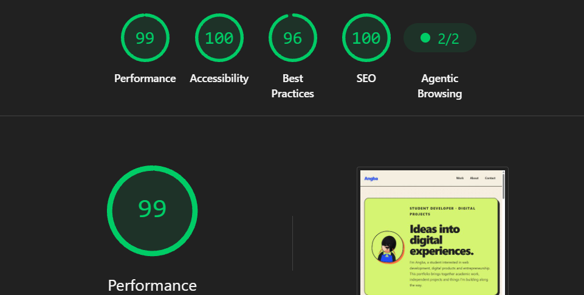
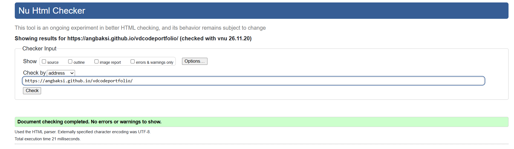

# Angelo Portfolio

A personal portfolio featuring selected projects, background information, and contact details.

## Technologies

- HTML5
- CSS3

## Website sections

- **About:** Introduction and portrait.
- **Work:** Selected academic and independent projects.
- **Contact:** Contact form and contact details.

## Project structure

```text
.
├── index.html
├── styles.css
├── images/
│   └── portrait.svg
├── files/
│   ├── own-the-economy-litepaper.pdf
│   └── own-the-economy-pitch.pdf
└── portrait.svg
```

## Run locally

Open the project folder in VS Code, install the **Live Server** extension if needed, then right-click `index.html` and select **Open with Live Server**.

## Accessibility Testing

### Chrome Lighthouse



- Chrome Lighthouse: Accessibility 100/100.

### W3C HTML Validator



- W3C HTML Validator: 0 errors and 0 warnings.
